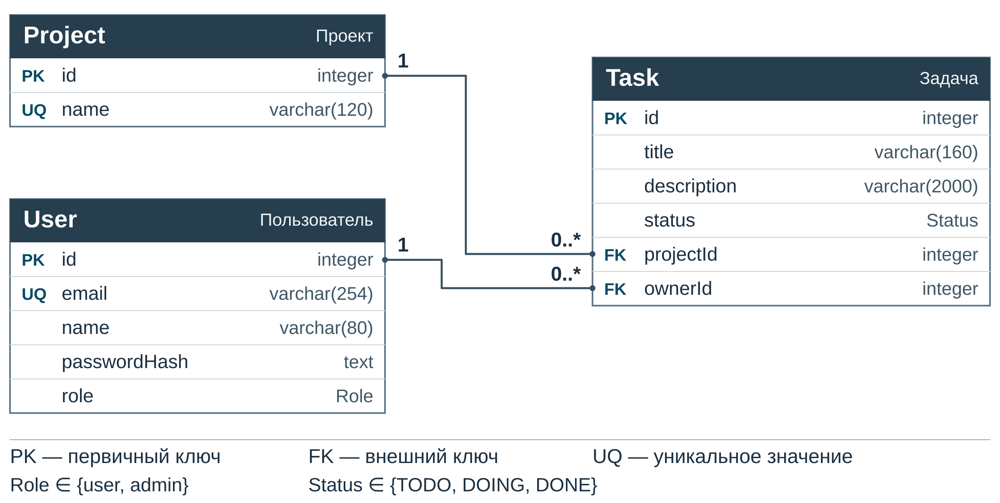

# Контур · REST API для системы управления задачами

Курсовая работа по ПМ4 «Разработка браузерных приложений». Исполнитель ведёт свои задачи в проектах, видит статусы и меняет карточки. Администратор может работать с задачами всех исполнителей и просматривать пользователей. Весь интерфейс использует тот же API, что и тесты.

## Запуск на этом компьютере

В папке проекта откройте терминал и выполните `npm start` или `bash "Запустить сайт.sh"`. Откройте http://127.0.0.1:4174, когда появится сообщение о готовности. Остановка из терминала — Ctrl+C. Для пустой личной доски перейдите на вкладку «Регистрация», затем войдите. Для готового примера используйте значения `DEMO_EMAIL` и `DEMO_PASSWORD` из скрытого локального файла `.env`. Для административной демонстрации — `ADMIN_EMAIL` и `ADMIN_PASSWORD` из него же. В файловом менеджере Ctrl+H показывает скрытые файлы.

## Запуск из чистой копии

Установите Git и Node.js 22.12 или новее с npm. На проверенном компьютере использована Linux x64 и Node.js 26.13.0. Установщики Node.js доступны на [официальном сайте](https://nodejs.org/en/download). Для быстрой установки потребуется интернет, свободные порты 4174 (сайт) и 55434 (БД) и непривилегированная учётная запись.

```sh
git clone https://github.com/vladimirsnow/taskboard-rest-api-coursework.git
cd taskboard-rest-api-coursework
npm ci
npm start
```

Быстрый режим создаёт закрытый файл `.env` с разными случайными паролями и ключом подписи. Пакет embedded-postgres запускает отдельный процесс настоящего PostgreSQL 18.7. Данные хранятся в `.local/postgres`. Prisma генерирует клиент и применяет сохранённую SQL-миграцию. Посев добавляет три проекта, администратора и демонстрационного исполнителя с пятью задачами. При повторном запуске прежние карточки сохраняются. Для второго экземпляра в отдельной чистой папке до первого старта можно выполнить `PORT=4184 LOCAL_DB_PORT=55444 npm start`.

### Собственная база PostgreSQL

Установите PostgreSQL по [инструкции для своей ОС](https://www.postgresql.org/download/). В новой копии проекта скопируйте `.env.example` в `.env`. Создайте выделенную БД и пользователя в psql под администратором сервера:

```sql
CREATE ROLE taskboard LOGIN;
\password taskboard
CREATE DATABASE taskboard OWNER taskboard;
```

Запишите в `DATABASE_URL` строку подключения к этой БД, закодировав специальные символы пароля в URL. Укажите случайный `JWT_SECRET` длиной от 32 символов и разные локальные пароли для двух учебных аккаунтов. Ключ можно получить командой `node -e "console.log(require('node:crypto').randomBytes(48).toString('hex'))"`. Для Linux ограничьте доступ к файлу командой `chmod 600 .env`.

```sh
npm ci
npx prisma generate
npm run db:deploy
npm run db:seed
npm run start:external
```

## Модель данных



Каждая задача принадлежит одному проекту и одному исполнителю. У проекта и у исполнителя может быть ноль или несколько задач. Роль и статус — перечисления PostgreSQL. Поля email и название проекта уникальны.

## Структура

| Путь | Назначение |
|---|---|
| server.js, routes/ | Express и сопоставление методов с обработчиками |
| controllers/ | Чтение параметров, проверка тела, формирование ответа |
| services/ | Операции с задачами, профилями, проектами и токенами |
| middleware/ | Проверка JWT, роли и обработка ошибок |
| config/ | Клиент Prisma, схемы Zod, выбор открытых полей |
| prisma/ | Модель, SQL-миграция и файл провайдера |
| public/ | Интерфейс, стили и ES-модули |
| scripts/ | Первый запуск, подключение PostgreSQL, посев, тестовый запуск |
| tests/ | Интеграционные проверки по HTTP на Python 3 |

## Контракт API

Все примеры используют условные идентификаторы и вымышленные реквизиты. Адрес сервера по умолчанию `http://127.0.0.1:4174`. Ответы API имеют тип `application/json`. Пустой список обозначается `[]`. Для недоступной чужой задачи действует тот же 404, что при отсутствии записи. Схемы записи отклоняют лишние поля, включая `role`, `userId` и `ownerId`. Сервер определяет владельца по проверенному JWT.

### POST /api/auth/register

Создать профиль с ролью user. Доступ: Гость. Параметры: name (1–80), email (до 254), password (10–128).

```http
Accept: application/json
Content-Type: application/json
```

Пример тела запроса:

```json
{
  "name": "Мария",
  "email": "maria@example.test",
  "password": "ExampleOnly-2026!"
}
```

Пример ответа (201):

```json
{
  "user": {
    "id": 4,
    "name": "Мария",
    "email": "maria@example.test",
    "role": "user"
  }
}
```

Ошибки: 400, 409, 500.

### POST /api/auth/login

Начать сеанс на один час. Доступ: Гость. Параметры: Почта и пароль зарегистрированного пользователя.

```http
Accept: application/json
Content-Type: application/json
```

Пример тела запроса:

```json
{
  "email": "maria@example.test",
  "password": "ExampleOnly-2026!"
}
```

Пример ответа (200):

```json
{
  "user": {
    "id": 4,
    "name": "Мария",
    "email": "maria@example.test",
    "role": "user"
  },
  "accessToken": "<accessToken>"
}
```

Ошибки: 400, 401, 500.

### GET /api/projects

Прочитать общий справочник проектов. Доступ: user, admin. Параметры: Нет.

```http
Accept: application/json
Authorization: Bearer <accessToken>
```

Тело запроса отсутствует.

Пример ответа (200):

```json
{
  "projects": [
    {
      "id": 1,
      "name": "Разработка API"
    }
  ]
}
```

Ошибки: 401, 500.

### GET /api/tasks

Прочитать задачи от большего id к меньшему. Доступ: user — свои; admin — все. Параметры: Нет. Фильтры доски работают в браузере.

```http
Accept: application/json
Authorization: Bearer <accessToken>
```

Тело запроса отсутствует.

Пример ответа (200):

```json
{
  "tasks": [
    {
      "id": 7,
      "title": "Проверить форму",
      "description": "",
      "status": "TODO",
      "projectId": 1,
      "ownerId": 4,
      "project": {
        "id": 1,
        "name": "Разработка API"
      },
      "owner": {
        "id": 4,
        "name": "Мария"
      }
    }
  ]
}
```

Ошибки: 401, 500.

### GET /api/tasks/:id

Открыть задачу со связанными проектом и исполнителем. Доступ: user — своя; admin — любая. Параметры: id в пути, положительное целое, например 7.

```http
Accept: application/json
Authorization: Bearer <accessToken>
```

Тело запроса отсутствует.

Пример ответа (200):

```json
{
  "task": {
    "id": 7,
    "title": "Проверить форму",
    "description": "",
    "status": "TODO",
    "projectId": 1,
    "ownerId": 4,
    "project": {
      "id": 1,
      "name": "Разработка API"
    },
    "owner": {
      "id": 4,
      "name": "Мария"
    }
  }
}
```

Ошибки: 400, 401, 404, 500.

### POST /api/tasks

Создать задачу и назначить текущего пользователя исполнителем. Доступ: user, admin. Параметры: Обязательны title (1–160) и числовой projectId. Допускаются description (до 2000) и status (TODO, DOING, DONE).

```http
Accept: application/json
Content-Type: application/json
Authorization: Bearer <accessToken>
```

Пример тела запроса:

```json
{
  "title": "Проверить форму",
  "projectId": 1
}
```

Пример ответа (201):

```json
{
  "task": {
    "id": 7,
    "title": "Проверить форму",
    "description": "",
    "status": "TODO",
    "projectId": 1,
    "ownerId": 4,
    "project": {
      "id": 1,
      "name": "Разработка API"
    },
    "owner": {
      "id": 4,
      "name": "Мария"
    }
  }
}
```

Ошибки: 400, 401, 500.

### PATCH /api/tasks/:id

Изменить переданные свойства. Доступ: user — своя; admin — любая. Параметры: id в пути. В теле хотя бы одно поле из title, projectId, status, description.

```http
Accept: application/json
Content-Type: application/json
Authorization: Bearer <accessToken>
```

Пример тела запроса:

```json
{
  "status": "DONE"
}
```

Пример ответа (200):

```json
{
  "task": {
    "id": 7,
    "title": "Проверить форму",
    "description": "",
    "status": "DONE",
    "projectId": 1,
    "ownerId": 4,
    "project": {
      "id": 1,
      "name": "Разработка API"
    },
    "owner": {
      "id": 4,
      "name": "Мария"
    }
  }
}
```

Ошибки: 400, 401, 404, 500.

### DELETE /api/tasks/:id

Удалить задачу. Доступ: user — своя; admin — любая. Параметры: id в пути, например 7.

```http
Accept: application/json
Authorization: Bearer <accessToken>
```

Тело запроса отсутствует.

Пример ответа (200):

```json
{
  "deleted": true
}
```

Ошибки: 400, 401, 404, 500.

### GET /api/admin/users

Прочитать пользователей и роли. Доступ: admin. Параметры: Нет.

```http
Accept: application/json
Authorization: Bearer <accessToken>
```

Тело запроса отсутствует.

Пример ответа (200):

```json
{
  "users": [
    {
      "id": 4,
      "name": "Мария",
      "email": "maria@example.test",
      "role": "user"
    }
  ]
}
```

Ошибки: 401, 403, 500.

### Формат ошибки

```json
{"error":{"message":"Задача не найдена."}}
```

| Статус | Причина |
|---|---|
| 400 | Нарушена схема, пустой PATCH, неверный id, неизвестный проект или некорректный JSON |
| 401 | Нет действующего Bearer-токена или не прошла проверка пары почта/пароль |
| 403 | Для административного справочника требуется роль admin |
| 404 | Маршрут или доступная задача отсутствуют |
| 409 | Почта уже зарегистрирована |
| 500 | Непредвиденный внутренний сбой |

## Проверка и демонстрация

1. Поднимите сервер. Войдите через форму или выполните запрос login из справочника выше. В Postman выберите Bearer Token и вставьте полученное значение accessToken.
2. Получите список проектов, используйте действительный projectId для POST задачи. Прочтите её по id, выполните PATCH со статусом DONE, убедитесь, что название и владелец сохранены. Удалите запись и проверьте повторный GET (404).
3. Выполните GET /api/tasks без Authorization (401). С токеном обычного пользователя запросите /api/admin/users (403). Повторите с токеном администратора (200).
4. Для автоматического прогона используйте отдельную копию с тестовой базой, поднимите её как описано выше. Во втором терминале из этой же папки выполните `npm test`. Нужен Python 3.9 или новее (команда `python3`, имя можно задать переменной `PYTHON`). Тесты создают уникальные тестовые аккаунты, выполняют HTTP-запросы, проверяют коды и JSON. Созданные учётные записи остаются в тестовой БД. Для прямого запуска: `python3 -B -m unittest discover -s tests -v` с переменными API_URL, ADMIN_EMAIL и ADMIN_PASSWORD.

Сайт и база в быстром режиме слушают локальный адрес. Для учебной защиты достаточно одного компьютера. Личные реквизиты, двоичные зависимости, локальная БД и отчёт Word исключены из Git.

## Проверенные окружения

Приложение прошло все 14 HTTP-тестов на Linux x64 с Node.js 26.13.0 и на отдельной виртуальной машине Debian 12.15 с Node.js 22.16.0. В гостевой системе использовались собственные процессы Node.js и PostgreSQL, свой файл .env и собственная база. В GitHub Actions предусмотрен ручной запуск того же сценария при наличии доступного runner.
